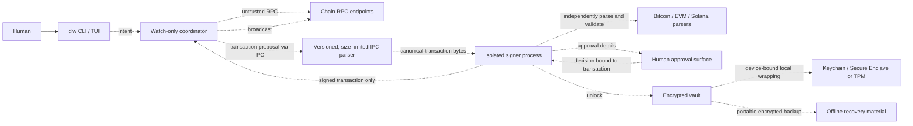

# Architecture

## Scope and trust boundaries

Phase 1 builds only the CLI/TUI and descriptive library contracts. The diagram describes the intended later architecture; dashed paths are **not implemented**. There is no signer process, IPC service, encrypted vault, hardware binding, RPC adapter, or key material today.

The CLI/TUI takes user intent and presents information. The future coordinator owns watch-only addresses, balances, fee estimates, and network access. RPC responses and any transaction proposal crossing IPC are untrusted. The future signer must parse canonical transaction bytes independently, verify chain/network, recipients, values, fees, change, and any contract or program effects it can understand, and reject unsupported forms. UI summaries cannot authorize signing.

The signer process is a planned operating-system process boundary, not a Phase 1 feature. IPC should use a versioned, narrow protocol with explicit length limits, authenticated local peer identity where supported, replay protection, and fail-closed parsing. The coordinator should receive only signed transaction data or sanitized errors. Private keys and seed material must never cross into the coordinator or terminal interface.

The vault will hold encrypted wallet secrets. Hardware assistance is intended to protect or unwrap a local encryption key, while an independently recoverable encrypted backup permits migration after device loss. The exact KDF, AEAD, backup format, and recovery ceremony require review before implementation. Conventional chain signatures may still require short-lived software key material inside the signer process.

Chain crates currently expose only target identifiers. Later adapters should own chain-specific decoding, normalization, and RPC data mapping. Signing policy and authorization remain inside the signer boundary, not in adapters that process network data. There is deliberately no generic arbitrary-message signing API.

## Dependency direction

`clw-core` contains non-secret common types. The CLI depends on `clw-core` and `clw-security`. The vault, signer, and chain crates depend only on `clw-core` today. No chain crate depends on network libraries or signer internals. This keeps network code out of the future signer by default.
